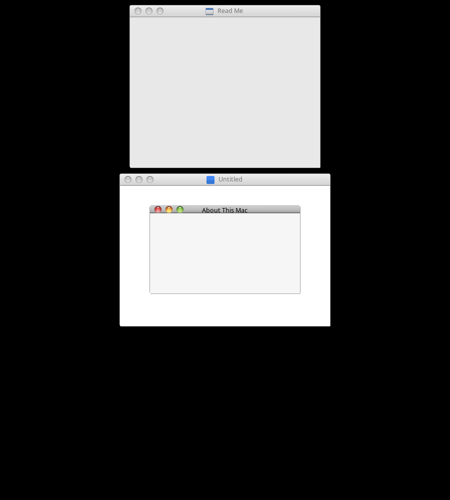

# WindowServerWM — Openbox

The window manager of lynxOS: macOS X-like window management. Built on the
upstream openbox base, with:

Current state (macOS X title bar rendered with the real cougar assets:
caption-strip nine-slice, traffic-light PNGs per state, centered title):

- **No preferences, no user configuration.** The configuration is a system
  asset read from a hardcoded location, and so is the theme:

      /System/Library/CoreServices/WindowServerWM/rc.xml      the configuration
      /System/Library/CoreServices/WindowServerWM/themes/<name>/  themes (active: "WindowServer")

  The default menu no longer runs obconf or carries the other desktops'
  settings entries. For development outside lynxOS there are environment
  overrides (WINDOWSERVERWM_CONFIG_PATH, WINDOWSERVERWM_THEMES_PATH) and the
  standard XDG search still applies as a fallback when the hardcoded paths
  don't exist.

- **macOS X title bar layout.** Theme layout `CIMNL` (close, iconify,
  maximize on the left, then the window icon beside the centered title,
  nothing on the right); the title is centered in the whole bar by
  openbox/frame.c (layout_title), and slides out from under the buttons if
  it would overlap them. When the asset pack is present
  (themes/WindowServer/openbox-3/assets/, attribution in assets/README),
  obrender/theme.c draws the
  titlebar as cougar's caption strip (nine-slice) and the traffic lights as
  cougar pngs per state, with
  the header height and button metrics from aurora's properties.ini
  (23 px caption, 16 px buttons, centered vertically); without the assets
  the built-in glyph masks colored like traffic lights are the fallback.
  Dialog and Utility windows get the compact 14 px caption ("small
  titlebar"): the 14x16 control cells keep their intrinsic size and are
  clipped by the shorter strip, never scaled. Titles are regular weight.

- The caption strip comes in as a nine-slice texture (RR_TEXTURE_9SLICE in
  obrender) and images load through libpng (USE_LIBPNG in obrender/image.c).
  Window shadows are not drawn yet: openbox has no compositor. The
  toolbar-merged variant of the reference chrome is left to the client
  apps (openbox only owns the caption strip). The asset spec lives in
  guide_PRIVATE/windowcontrols_Ref/DESIGN-GUIDE.md.

- Real assets/layout work continues as the lynxOS desktop components land.

# Credits
Art: https://gitgud.io/x6shell/aurora
Openbox Window Manager: https://github.com/danakj/openbox

----
    This software is OSI Certified Open Source Software.
    OSI Certified is a certification mark of the Open Source Initiative.

----
    This program is free software; you can redistribute it and/or modify
    it under the terms of the GNU General Public License as published by
    the Free Software Foundation; either version 2 of the License, or
    (at your option) any later version.

    This program is distributed in the hope that it will be useful,
    but WITHOUT ANY WARRANTY; without even the implied warranty of
    MERCHANTABILITY or FITNESS FOR A PARTICULAR PURPOSE.  See the
    GNU General Public License for more details.

    See the COPYING file for a copy of the GNU General Public License.

---
Copyright (C) 2004  Mikael Magnusson
Copyright (C) 2002  Dana Jansens