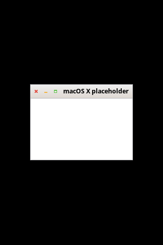

# Openbox

Copyright (C) 2004  Mikael Magnusson
Copyright (C) 2002  Dana Jansens

---------------------------------------------------------------------------

# WindowServerWM — lynxOS fork of Openbox

The window manager of lynxOS: macOS X-like window management. Built on the
upstream openbox base, with:

Current state (placeholder macOS X title bar, traffic lights on the left,
title centered in the bar):

- **No preferences, no user configuration.** The configuration is a system
  asset read from a hardcoded location, and so is the theme:

      /Library/WindowServerWM/rc.xml          the configuration
      /Library/WindowServerWM/Themes/<name>/  themes (active: "WindowServer")

  The default menu no longer runs obconf or carries the other desktops'
  settings entries. For development outside lynxOS there are environment
  overrides (WINDOWSERVERWM_CONFIG_PATH, WINDOWSERVERWM_THEMES_PATH) and the
  standard XDG search still applies as a fallback when the hardcoded paths
  don't exist.

- **macOS X title bar layout.** Theme layout placeholder `CIML` (close,
  iconify, maximize on the left of the title, nothing on the right); the
  title is centered in the whole bar by openbox/frame.c (layout_title), and
  slides out from under the buttons if it would overlap them. The bundled
  "WindowServer" theme is a placeholder: flat macOS-ish colors and the
  built-in button glyphs colored like traffic lights (close = red,
  iconify = yellow, maximize = green), no image assets yet.

- Real assets/layout work continues as the lynxOS desktop components land.

---------------------------------------------------------------------------

----

    This software is OSI Certified Open Source Software.
    OSI Certified is a certification mark of the Open Source Initiative.

----

    This program is free software; you can redistribute it and/or modify
    it under the terms of the GNU General Public License as published by
    the Free Software Foundation; either version 2 of the License, or
    (at your option) any later version.

    This program is distributed in the hope that it will be useful,
    but WITHOUT ANY WARRANTY; without even the implied warranty of
    MERCHANTABILITY or FITNESS FOR A PARTICULAR PURPOSE.  See the
    GNU General Public License for more details.

    See the COPYING file for a copy of the GNU General Public License.

